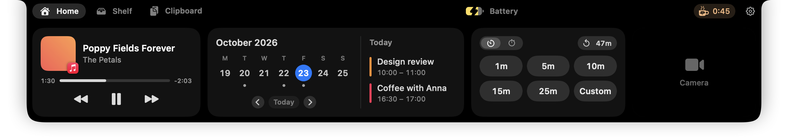
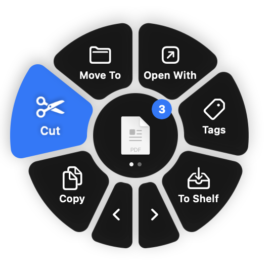

<h1 align="center">PoppyDesk</h1>

Your notch, finally useful. A free, modular menu bar app for Mac.

<a href="https://github.com/VolodymyrDem/PoppyDesk/releases/latest/download/PoppyDesk.dmg"><b>Download for Mac</b></a> · <a href="https://volodymyrdem.github.io/PoppyDesk/">Website</a> · <a href="https://github.com/VolodymyrDem/PoppyDesk/releases">What's new</a>

---

A shelf in the notch, a clipboard wheel, a tidy menu bar and a few small helpers. Turn on only the modules you want; the rest don't run and don't ask for anything.

| Module | What it does |
|---|---|
| **Notch** | Hover the notch for what's playing, your week, a timer and a stopwatch, a shelf for files and AirDrop. |
| **Clipboard Wheel** | Drag anything, tap Control, and drop on Copy, Cut, Copy Path, AirDrop and more. |
| **Clipboard History** | Everything you copy, a shortcut away, with search and pins. |
| **Menu Bar** | *Beta, off until you turn it on.* Click the poppy to hide the icons left of its divider. |
| **Battery** | How full it is and where the power goes, with the watts coming in by the notch. |
| **Keep Awake** | Keeps the Mac from sleeping for as long as you like, from the notch or the menu bar. |
| **Eye Breaks** | Reminds you to look at something far away now and then. |
| **Sound** | Each app's volume, and where the sound goes. |

**Requires** macOS 14 Sonoma or later, on Apple silicon or Intel.

## Installing

1. Download **PoppyDesk.dmg** and drag PoppyDesk into Applications.
2. Open it. macOS says it can't check it, since PoppyDesk isn't notarized yet; click **Done**.
3. Open **System Settings → Privacy & Security**, scroll down and click **Open Anyway** next to PoppyDesk.

After that PoppyDesk updates itself.

## Feedback

[Report a problem](https://github.com/VolodymyrDem/PoppyDesk/issues/new?template=bug_report.yml) or [suggest an idea](https://github.com/VolodymyrDem/PoppyDesk/issues/new?template=feature_request.yml) here, or from **Settings → About** in the app.

## License

PoppyDesk is free to use, but not open source: see [LICENSE.md](LICENSE.md). [Privacy](https://volodymyrdem.github.io/PoppyDesk/privacy.html): nothing is collected.
